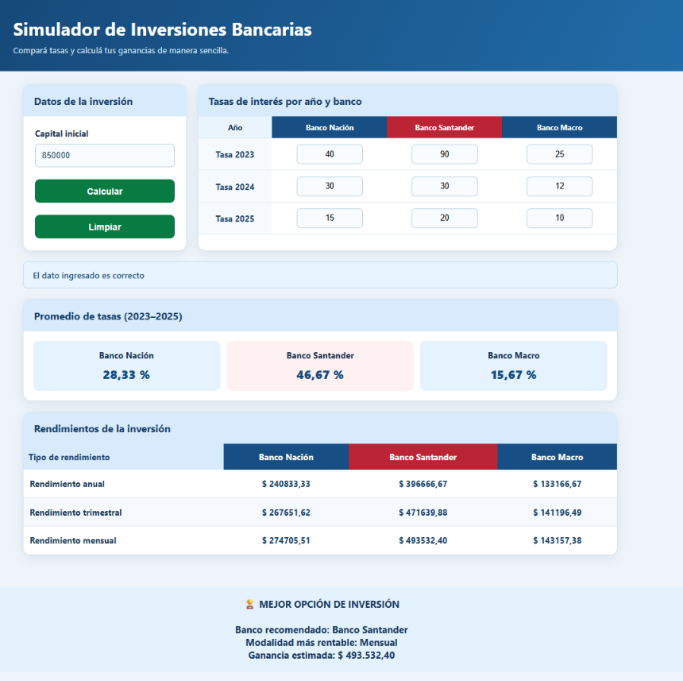

# Simulador de inversiones en plazos fijos

Proyecto académico correspondiente al **Parcial 2 de Introducción al Análisis de Datos** de la Tecnicatura Universitaria en Programación — UTN FRGP.

## Vista previa de la aplicación

*Ejemplo de simulación con un capital inicial de $850.000 y tasas de interés ficticias.*

## Objetivo

Desarrollar una aplicación web que permita comparar diferentes opciones de inversión en plazos fijos y determinar qué banco y modalidad ofrecen la mayor ganancia estimada durante un año.

El programa trabaja con Banco Nación, Banco Santander y Banco Macro, a partir de las tasas históricas ingresadas por el usuario para los años 2023, 2024 y 2025.

## Tecnologías utilizadas

- C#
- ASP.NET Web Forms
- .NET Framework
- HTML y CSS
- Visual Studio
- IIS Express

## Funcionalidades

- Ingreso de un capital inicial (valor de referencia: $850.000).
- Ingreso de tres tasas anuales por banco.
- Validación de datos numéricos mayores que cero mediante `decimal.TryParse`.
- Cálculo de la tasa promedio anual de cada banco.
- Cálculo de rendimientos anuales, trimestrales y mensuales.
- Simulación de reinversión mediante interés compuesto.
- Comparación de rendimientos y contemplación de empates entre bancos.
- Presentación del banco recomendado, la modalidad más rentable y la ganancia estimada.
- Limpieza del formulario para realizar nuevas simulaciones.

## Modalidades de inversión

| Modalidad | Descripción |
| --- | --- |
| Anual | Inversión durante un año completo, sin reinversión intermedia. |
| Trimestral | Capitalización de intereses cada tres meses, durante cuatro períodos. |
| Mensual | Capitalización de intereses cada mes, durante doce períodos. |

El rendimiento representa únicamente la ganancia obtenida, sin incluir el capital inicial.

Bajo las condiciones del simulador —misma tasa nominal anual positiva para las tres modalidades, tasa constante y ausencia de costos adicionales— la capitalización mensual genera una mayor ganancia debido al interés compuesto.

## Organización del código

La interfaz se encuentra en `Inicio.aspx` y la lógica del programa en `Inicio.aspx.cs`.

| Método | Responsabilidad |
| --- | --- |
| `btnCalcular_Click` | Validar los datos, ejecutar los cálculos y mostrar los resultados. |
| `CalcularPromedio` | Calcular el promedio de las tres tasas anuales. |
| `CalcularRendimientoAnual` | Calcular la ganancia anual. |
| `CalcularRendimientoTrimestral` | Calcular la ganancia con capitalización trimestral. |
| `CalcularRendimientoMensual` | Calcular la ganancia con capitalización mensual. |
| `ObtenerMayorRendimiento` | Obtener el mayor rendimiento de un banco. |
| `CalcularMejorInversion` | Comparar los bancos e identificar la mejor opción o posibles empates. |
| `btnLimpiar_Click` | Limpiar los campos y resultados del formulario. |

## Cómo ejecutar el proyecto

1. Clonar o descargar el repositorio.
2. Abrir la solución del proyecto en Visual Studio con las herramientas de desarrollo de ASP.NET y .NET Framework instaladas.
3. Ejecutar el proyecto con IIS Express mediante `F5` o `Ctrl + F5`.
4. Ingresar el capital inicial y las tasas de interés.
5. Presionar **Calcular** para visualizar los resultados.

## Videos de presentación

Los siguientes videos corresponden a la demostración del funcionamiento del programa y a la explicación de su código fuente:

- [Video 1](https://youtu.be/FzrcCG-sFX0)
- [Video 2](https://youtu.be/ZSATvXT_5ec)

## Autor

**Sonia Vertz **  
Tecnicatura Universitaria en Programación  
Universidad Tecnológica Nacional — Facultad Regional General Pacheco  
2026

---

Proyecto desarrollado con fines educativos. Las tasas son ingresadas por el usuario y los resultados constituyen una simulación, no una recomendación financiera real.
